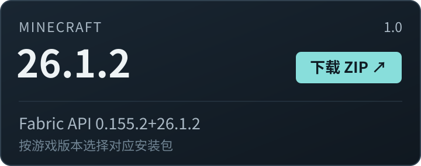
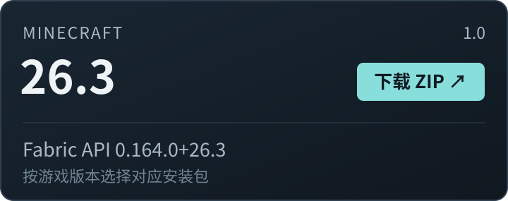

  

<picture>
  <source media="(max-width: 640px)" srcset="展示资源/homepage-20261023/brand-compact.svg">
  
</picture>

  <a href="#下载与安装"><strong>下载安装 ↗</strong></a> &nbsp; · &nbsp;
  <a href="功能指南.md"><strong>功能指南 ↗</strong></a> &nbsp; · &nbsp;
  <a href="界面预览.md"><strong>界面预览 ↗</strong></a>

### 核心能力

  
  
  
  

<a href="功能指南.md">
  <picture>
    <source media="(max-width: 640px)" srcset="展示资源/homepage-20261023/resource-compact.svg">
    
  </picture>
</a>

### 下载与安装

  
  

  

**26.1.2 / 26.2 / 26.3 运行环境** &nbsp; Windows x64 · Java 25 · Fabric Loader 0.19.5+

解压 ZIP，将 JAR 与对应 Fabric API 放入 <code>mods</code>。Baritone 已内置。

[安装指南 →](安装指南.md) &nbsp; · &nbsp; [版本与兼容 →](版本说明.md) &nbsp; · &nbsp; [查看更新记录 →](https://github.com/fxjcangku/yiyiaddon/releases/tag/v1.0)

### 文档与支持

[反馈问题](https://github.com/fxjcangku/yiyiaddon/issues) &nbsp; / &nbsp; [常见问题](常见问题.md) &nbsp; / &nbsp; [服务器使用注意](服务器使用注意.md) &nbsp; / &nbsp; [Discord](https://discord.gg/vwrRCtET)

顶部动画为功能概念展示；实际表现以当前版本与服务器支持为准。本项目与 Mojang、Microsoft 无关联。
