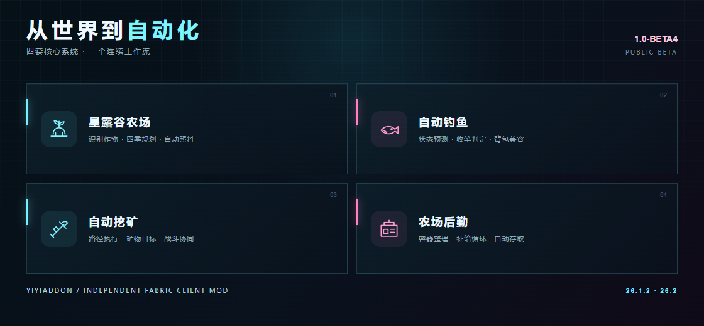

# 功能指南

概念图用于介绍功能，不是实机截图。具体设置和当前限制以游戏内模块说明为准。

**版本范围**：正式安装包覆盖 Minecraft 26.1.2、26.2 与 26.3，配套 Fabric API 见[版本与兼容](版本说明.md)。Minecraft 1.21.11 的适配信息见 [1.2 更新预告](https://github.com/fxjcangku/yiyiaddon/releases/tag/v1.2-preview)，暂无公开安装包。

本页通知栏和附魔场景的验证记录来自 Beta9.1 阶段的 26.1.2 / 26.2 单人客户端与最终安装包，正式版 1.0 沿用这些结果；不扩展为 26.3 的验收记录，原服务器业务和长期挂机未验。

## 手动记录问题日志（2026-10-26 本地交付包）

每个模块都可以用自己的指令开启、停止取证，格式与星露谷农场一致。请分两次输入：先开始记录，复现问题，再停止保存。

| 模块 | 开始记录 | 停止并保存 |
| --- | --- | --- |
| 星露谷农场 | `.stardew 取证 开始` | `.stardew 取证 停止` |
| 星露谷钓鱼 | `.fish 取证 开始` | `.fish 取证 停止` |
| 自动挖矿（含种子挖矿） | `.wk 取证 开始` | `.wk 取证 停止` |
| 自动附魔 | `.fumo 取证 开始` | `.fumo 取证 停止` |
| 自动找箱 | `.autochest 取证 开始` | `.autochest 取证 停止` |

其余模块同样在原指令后加 `取证 开始` 或 `取证 停止`；没有原指令的模块使用模块 ID，可在 `.help` 查看并用 Tab 补全。若已修改客户端指令前缀，使用自己的前缀。

记录开关不改变模块开关。模块未启用时也可以先开始取证，再手动开启模块复现。停止后等待文件保存回执：聊天的服务器信息区域会显示 ZIP 文件名和可点击的 `【日志目录】`。只有成功写出文件才显示保存成功；取证提示是本地消息，不会发给其他玩家。

将整个 ZIP 私下反馈。包内含中文摘要、版本与会话信息、详细事件：可对照任务阶段、目标、重试、扫描结果、补水、移动输入、视角、碰撞、路径、背包与菜单，以及发送动作和服务器实际反馈。请求已发送不等于服务器已完成；摘要没有失败文字也不表示一定没有 Bug。日志有容量与截断提示，密码及认证参数隐藏，服务器、坐标和相关物品仍会保留。

普通模块日志在游戏实例的 `logs/module-traces/<模块ID>/`，农场仍在 `StardewFarm/debug/farm/`。旧钓鱼专用 debug 等入口继续保留。本节对应本地交付包，尚未替换公开下载附件。

## 新版界面与目标选择

配置页的详细中文说明常驻在控件下方，随可用宽度自动换行；正文、默认值和警告按当前深浅主题保持清楚的对比度。原有彩色语义保留，「默认关闭／默认开启／只读」有独立强调。HUD、HUD 设置及从 HUD 打开的子弹窗沿用原样式。

默认按 **G** 打开主配置，已改键时使用自己的快捷键。首次打开新版主配置时提供导览，保留全部业务配置；无需删除文件或重新设置所有目标。页签、折叠与滚动位置只在本次客户端启动中记忆，重启后重新打开。

**1.0 已发布：首页本次会话**增加主手、副手的物品 ID 和服务器自定义 ID，点击对应项复制完整代码，长内容可悬停查看；空手或没有自定义 ID 时不复制占位文字。XYZ 仅用空格分隔三个坐标，例如 `10 72 10`，点击后可直接粘贴。双手读数随当前物品更新，只在本地显示。

分类图标卡片用于物品、方块、实体、装备、附魔书和服务器资源目标。按分类、用途或品质浏览，也可搜索；候选与已选直接切换。单选移除当前项后再换，多选批量仅作用于当前结果。旧目标失效后仍可从已选中移除。

作物与种子分别显示真实图标和说明。服务器图标缺失时会提示，不用载体外观代替。模块运行中先停止再修改任务目标，旧弹窗也会复核当前资源与任务状态。

## 聊天增强（1.1 待验收）

聊天中的服务器信息和玩家消息分别显示在有边框的区域内。打开聊天后，可查看「全部」「附近」「私聊」「@我」，或使用搜索查找消息；这些按钮只筛选查看内容，实际发送目标在面板底部选择。关闭聊天后，两类提示仍显示全部分组的新消息，不沿用刚才的查看筛选。

服务器信息使用红色，玩家消息使用绿色，时间戳跟随所属分组并显示到秒。头像放在姓名前，自动补充的头像位于 `<姓名>` 等括号外，时间戳前不留空栏；姓名与消息保留原有颜色，自己的发言增加深红背景。默认采用深色少女粉主题，也可切换浅色主题，已有主题选择继续保留。

- **调整布局**：拖动标题移动面板，拖动边缘或角落缩放。在「设置 → 常用 → 调整提示位置」中，可分别拖动关闭聊天后的服务器、玩家提示；保存到当前服务器，取消则保留原位置。
- **设置频道**：进入「聊天频道」，分别配置公屏、附近或额外频道。按本服规则选择「先切换频道」或「每条加命令」；切换方式会先填入命令，仍需按 Enter 确认。没有附近频道时无需配置，私聊可单独设置；未配置公屏切换命令时，发送到服务器当前频道。
- **管理私聊**：在「私聊与联系人」设置本服命令与收件人，使用收藏和最近联系人选择对象；查看私聊分组不会替你改变发送目标。
- **添加快捷指令**：进入「快捷指令」，填写名称和一条以 `/` 开头的命令，选择物品图标，并为这一条单独绑定按键后保存。最多保存 12 条，支持编辑、排序和删除；前三条常驻快捷栏，顶部入口可查看全部。
- **直接执行**：点击快捷按钮，或在游戏中使用该指令的绑定键，无需再按 Enter。执行保留已有聊天草稿与发送目标；服务器是否接受命令、是否完成操作，以实际响应为准。
- **恢复默认**：设置顶栏提供确认复位，覆盖聊天显示、布局和本服频道、命令、识别设置；其他服务器配置、消息与联系人保留。五个设置分类分别为常用、聊天频道、私聊与联系人、快捷指令、外观与兼容。

频道、私聊、快捷指令与关闭后的提示位置按服务器保存。不同服务器的命令并不通用，应先确认本服用法再填写；兼容表仅识别已安装模组及版本，不代表所有聊天插件均已验证。当前章节为 1.1 验收准备，正式下载与支持范围以发布页最终附件为准；三条版本线维护不等于三条版本线均公开发布。

## 模块播报与统计

自动模块消息集中进入右下角面板，不再刷聊天；普通玩家和服务器聊天照常显示。默认「精致窄形」，也可选择「横向状态栏」或「精致方形」。带图标的模块按钮用于切换查看，当前任务、模式和物品明细在同一处；主面板只显示简短状态，不铺点位坐标长串。

**1.2 预告**：HUD 相关设置与详情统一参照 HUD 总设置，使用原版真实图标、用途分区和可滚动正文。模块播报记录分为“播报记录”和“运行统计”：前者组合筛选来源、等级、结果与关键词，后者分别查看本轮小结和本服累计。指标选择、快捷操作及玩家、实体、装备、作物详情共用同一工作台，窗口变窄时自动重排，保留搜索草稿与阅读位置。当前仍为预告，以实际安装版本为准。

- **查看与调整**：约 8 秒无新播报后整个面板隐藏，新播报或打开聊天框后恢复。打开聊天框才能拖动、缩放，绿色提示在面板内部；窗口和 GUI 大小变化后自动适配，深浅色跟随主主题。
- **通知记录**：近期最多两条，短时重复合并；打开“记录”可按全部、成功、失败、停机筛选，长文滚动查看并复制完整内容。关闭显示总开关后，聊天中的“显示通知栏”可恢复。
- **账目与图标**：按模式累计真实确认数量，获得、入箱、出售、丢弃分开，全丢仍记获得；同服关闭再开启模块不清零，关闭期间不计挂机时长，离服结束本次会话。原版物品与服务器资源物品沿真实组件和本服资源包显示。
- **附魔三指标**：挂机时长、确认附魔、成品均时并排显示。确认附魔包含低耗刷新；成品均时只按真实命中目标累计，未命中时显示“等待命中”，每次确认均时另在详情查看。

运行、等待、暂停、异常、停止、完成六种状态来自模块实际流程。首次安装仅服务器检测和自动重生默认开启，已有开关保留；模块通知显示各自默认开启，隐藏面板不停止任务。

## 星露谷农场

适用于具有星露谷作物与资源的服务器。先等待服务器资源就绪，再配置区域、目标作物及后勤点位；检查季节、种子、工具与容器条件后启动。

农场与钓鱼的资源准备页、资源管理页先显示服务器和资源状态，提取按钮紧邻「查看资源包」上方。点击后在后台准备资源，等待状态完成再配置；换服或换包时不沿用上一份未完成的结果。资源准备进度与结果使用独立系统身份进入通知栏，无需先启用农场或钓鱼模块；本服资源识别仍需在目标服务器核对。

运行中通过控制台状态和日志查看当前任务。不同服务器的资源与点位不同，换服后应重新核对本服配置，不要直接照搬另一台服务器的设置。

资源名称优先使用本服资源和实际物品信息。资源包尚未就绪或缺少译名时，可能保留原名；显示名称不能代替服务器实际支持情况。

## 自动钓鱼

用于自动钓鱼流程中的状态判断与操作。先按游戏内说明完成配置，并在目标服务器验证收竿与钓获是否正常，再考虑长时间运行。

出现问题时请区分：没有执行操作、执行后服务器没有响应、服务器响应但没有钓获。反馈时注明是否打开背包或其他界面，有助于复现。

星露谷钓鱼的鱼竿、鱼饵、鱼钩集中在「目标」页，鱼竿严格单选，更换前先移除；鱼饵和鱼钩共用副手，不能同时选用。四项特殊能力仍需本服真实证据或玩家确认，图标和资源模型本身不授予能力。

鱼获图鉴只读，入箱鱼种沿原后勤清单；处理模式和阈值仍在后勤页。能力、识别说明与最近最多 12 条真实结果默认收起，展开查看；这不是跨重启保存的历史十二杆。

虚空模式取消丢弃某种保留材料后，可配置对应专用箱，默认攒到 32 个卸货；附魔瓶不按等级分箱，保留自身数据，不可堆叠时分别占格。穿戴与副手不参与卸货，自定义鞘翅留在背包。

### 虚空地图验证码（待发布）

确认当前鱼竿具有本服虚空垂钓能力后，在「运行 → 虚空验证」申请解锁「虚空钓鱼绕过验证码」。默认关闭，客户端确认新批准后自动开启并保存；同次批准只自动开启一次，手动关闭或恢复默认后，刷新与重启不会反复打开。旧版已通知批准的账号保留原开关选择。它与经典小游戏、普通 Shift、岩浆 Shift 辅助及调试取证互不依赖；按实际提示与 HUD 类型区分，地图验证占手时暂停其他钓鱼动作。手动修改仍遵守本模块的配置修改开关，实际提交始终需要近期后端确认。

仅关联本次服务器验证提示、主手填充地图和稳定完整像素后，才会保留大小写后台提交四位字符，同一次最多自动提交一次。不会打开聊天框、改变已有草稿或转动视角。无法可靠区分字形、大小写或粘连时不发送猜测，按通知手动处理；普通藏宝图不会触发自动提交。

已确认字体按原始大小逐像素比较全部 62 个字母数字，四字均唯一匹配时可提交，保留 `0/O/Q` 的笔画与大小写差别；近似匹配仍须满足原有严格分差，不能把相似度当作正确率。

地图占手期间自动钓鱼动作让出，鱼竿锁不抢回鱼竿。玩家先手动输入会取消自动提交；错误、超时或未收到确认不会自动重试。关闭开关仍可正常手动验证，调试验证码取证只负责记录，不控制正式自动验证。

验证完成后等待服务器撤图还竿，核对原鱼竿、原槽和真实同步，再检查钓点、渔具、鱼饵与浮漂条件。玩家已经暂停时保持暂停；仅由撤图还竿确认操作恢复时，不据此增加龙蛋奖励。断线、死亡、换服或资源失效后按通知处理，不继续旧验证码。

验证码仍占手时重新加载资源，钓鱼会停止并保留地图给你手动处理；完成验证后再重开模块，不会因为新资源已经准备好就自动抢回鱼竿。

26.1.2与26.2最后完整构建、专项及各24种隔离原件正反场已完成。正确`T3v5`由客户端自动识别并通过真实聊天链提交，服务端接收一次并接受、撤图还竿、继续下一杆均有记录；`t3v5`及`T3V5`是专用负面输入，服务端拒绝。“24场通过”还包含安全不发送及保持暂停，不表示错误大小写被接受。后台、死亡/断线/换维度、重载、编号重用、人工搬物、主背包还竿、真龙蛋拾取/入箱/计数和旧延迟动作保护也逐场核对。行为测试曾临时开放单人测试环境；两线均已恢复原单人限制并真实拒启，正常模组仍只支持多人服务器钓鱼。两张首轮随机混合字符图一张候选正确但安全门拒发、另一张自动提交接受并继续下一杆，不能据少量合成图推算原服未知验证码成功率。完整小游戏HUD、真实在途容器跨验证码、开关关闭后人工正确输入的完整恢复，以及原服仍待独立验收，详见[489复盘](../../02-开发报告/项目开发报告/03-复盘/489-复盘-虚空钓鱼自动地图验证与单人闭环.md)。

## 种子挖矿

先输入正确的世界种子，观察预测与真实方块的验证状态；证据不足时不能把预测直接当作可靠目标。主世界与下界分别验证，换维度不能沿用旧证据。

主世界支持钻石、红石、青金石、金、铁、铜、煤、绿宝石；下界支持远古残骸、下界石英、下界金。预测位置不等于服务器最终一定存在矿物，服务器自定义生成与防矿透环境可能影响结果。

## 自动挖矿与后勤

自动挖矿负责目标、路径、采掘与相关补给流程。启动前核对食物、工具、耐久和卸货条件；使用种子目标时还需通过对应验证。

自动箱子、农场补给与卸货依赖正确绑定的容器。出现等待或暂停时先看控制台原因；不要只凭角色没有移动就判断模块失效。

## 开界面与手动搬物

打开背包、箱子、聊天或设置界面，本身不会让自动化暂停。自动打开或关闭后台容器时保留你正在看的界面，不抢鼠标。

手动点击槽位、拿取或放回物品时，先由你操作。自动搬运与寻路会短暂交接，手中物品放妥、服务器确认后再继续；请勿在手里还拿着物品时要求自动流程同时搬运。菜单刚被更换时，模块会重新核对真实物品和目标，不能沿用旧槽位。无法确认的服务器菜单会保留供你处理。

普通右键和副手使用不会被当成打开容器。菜单来源无法确认时会提示并保留当前菜单，不会猜测目标重新打开；按提示处理后再继续。

## 自动附魔

自动附魔有原版附魔书、原版装备、自定义附魔书、自定义装备四种模式。自定义装备选择当前版本实际可附魔的一种装备，各品质按分类选择，目标列表与自定义书各自保留。目标匹配沿用自定义书：填写「打雷」接受任意等级，填写「打雷2」只接受二级，也支持罗马数字。

自定义装备默认每次领取一件，未命中就洗练这件再附；命中尚未完成的目标则存成品，已识别诅咒优先送废物箱。停机重开续用已跟踪原件；不能明确区分多件候选时先按提示整理背包，不会盲选或继续取新件。

原版装备只保留一种评分，按目标提升、实际铁砧费用与操作惩罚选择当前合并。默认每批四件，数量可调；四件准备 39 级后连续最高档附魔，共扣 12 级。合并经验不足先归还两件原装备，再去挂机点补足当前报价；生存费用过高时保留原件，不靠无限补级或磨掉优质装备解决。

四种模式分别保存本服箱子、附魔台、砂轮、挂机站位和视角，适用模式另有铁砧。首次使用各模式需独立绑定，绑定后切回恢复该模式配置；旧共享点位文件保留，不猜测归属或复制到四种模式。寻路只走已有通路，不拆方块、不搭桥，封闭目标需调整通路或点位。

完成记录按服务器和模式保存实际成品、词条、附魔次数和青金石。原版另列附魔等级、铁砧等级与合计，计费从本次启动或上一件成品确认存放后开始，包括用于合并、洗练的尝试；不猜测旧装备与重启前的历史成本。

每次新产书会提示实际词条和等级，介绍文字不当作附魔词条。命中本服诅咒名单的废书按配置分流。挂机到达附魔经验阈值时继续杀戮，不因开始附魔而单独暂停杀戮。

选择「挂机循环」后，「基础设置」显示自动丢弃清单；切换到纯附魔时隐藏入口并保留已选清单。清理仍在各运行阶段只丢你明确选择的物品 ID，并保护手持格；开着界面也能清理。启用前仍需核对本服诅咒名单、目标、附魔台、砂轮与存取箱点位，少量试用后再长时间挂机。

### 满包、前台交接与延迟

箱子、熔炉、工作台、砂轮等前台界面可以保持打开，后台沿真实菜单继续附魔。手动拿取、拖拽或放回物品时先交给玩家；光标清空且服务器同步后再接续，不拿旧界面的槽号操作新容器。走出工作台范围后，沿现有通路返回，前提是本服点位和路径仍有效。

书模式取回产物和青金石后，核对服务端完整内容以及本件物品、材料总数，再关闭工作台；背包临时腾位又被掉落物填满时会保留原台并重试归还，不能只看本地槽位暂时为空就关台。自动丢弃只清理已配置且未受保护的物品，不会为提速丢书或青金石。

原版书与自定义书的附魔按钮已发出、结果迟迟未确认时，按运行刻有限读回，约每 5 秒一次、最多 3 次。仍未知时提示原因并保留原书、材料和原事务，不重复发送附魔按钮、不领取替代书；同一事务迟到的真实结果只确认和计数一次。停机重开不能抹掉未知在途动作，原台已变化或证据不完整时仍需核对。

### 已验证范围与速度口径

26.1.2 / 26.2 单人客户端已通过本轮满包与真实掉落物再拾取、四类前台容器、随机手动搬物、离开交互范围后返回、拆堆移槽重开，以及 6 秒和 18 秒延迟结果恢复。测试期间核对书和青金石总量，并监测材料实体出生；这些结果不等同于所有服务器插件和长期挂机验收。

本轮两版各取 21 个完整周期，**自定义附魔书（CUSTOM）的低耗刷新中位约 0.70 秒/轮**，包含附魔、验货与砂轮洗练。条件为单人环境、工作台可达、一直附魔、三档智能、界面延迟 1 刻；不是“0.70 秒命中一本目标书”，也不是四种模式都达到这一速度。目标命中率、服务器延迟和插件行为会影响实际表现；预览图中的 **12.6 秒/本是演示值**。

## 自动村民交易

寻路单点和多任务的横向、上下搜索范围独立设置。上下默认各 2 格，可调 1～256；按村民脚底与本轮启动时玩家脚底的真实高差判断，边界包含。物流、跳跃或下台阶不改变本轮高度基准，停止再开会重新取基准。高台村民若比玩家脚底高 3 格，请至少调到 3，不能用工作站或头顶高度代替。原地模式保持原来的身边交互范围。

补给和卸货先寻找箱旁约两格内可达的站位，再打开容器；不再显示候选站位框。售罄记录按村民保留，重新打开真实报价可更新库存判断，补货倒计时只是预计时间。物资标签常驻显示实际物品图标，不必用准星指向。

后台旧交易菜单可以重开当前目标，避免把整排村民误当失败；无法确认的菜单留给手动处理。补给物资、可用背包格与卸货箱仍需满足设置条件，出现等待先看状态提示。当前服务器的持续交易、补给与手动搬物仍需实机复测。

出售材料不设补给量时，多种材料共同为绿宝石产出留空间，已有绿宝石堆叠余量也会参与计算。交易按真实付款、产出和找回材料核对容量，钻石一换一等能消费整槽的交易可以利用释放的格子。

材料已塞满且没有绿宝石可卸时，只退一整槽已选材料到它自己的绑定箱，再继续原目标，绝不丢弃。退料箱满或不可达时，先手动腾出背包空间，模块确认容量恢复后续接；只清理材料箱后要重试退料，需重启模块。结果还不明确时不会重复退料，补货可能少取最后一段以保留产出空间，不会自动精确拆组。当前容量和真实路线仍待实机复测。

## 自动丢弃

「指定丢弃」只处理明确选中的物品；「只保留」会丢弃白名单外且未受保护的物品，必须先设置白名单；「按数量保留」仅处理你配置了保留数量的物品。保护项仍然生效。

开界面仍可执行；手动搬物期间先交接，放妥物品后继续。「立即执行一次」也遵守交接与保护规则，修改规则会取消尚未执行的一次请求。首次使用请只带少量物品确认规则。

原版工具和护甲按所选类别匹配，同类附魔、等级和耐久差异不影响三种模式的匹配。精确服务器物品规则优先；身穿护甲不扫描，背包装备仍遵守主手、副手、工具及经验修补等保护设置。

## 其他模块

模块中心还提供 ID 识别、原版自动农场、自动骨粉、自动附魔、村民交易、图书管理员与世界显示等功能。各模块有独立前置条件，公开测试阶段的覆盖程度不同。

[安装指南](安装指南.md) · [常见问题](常见问题.md) · [返回首页](README.md)
