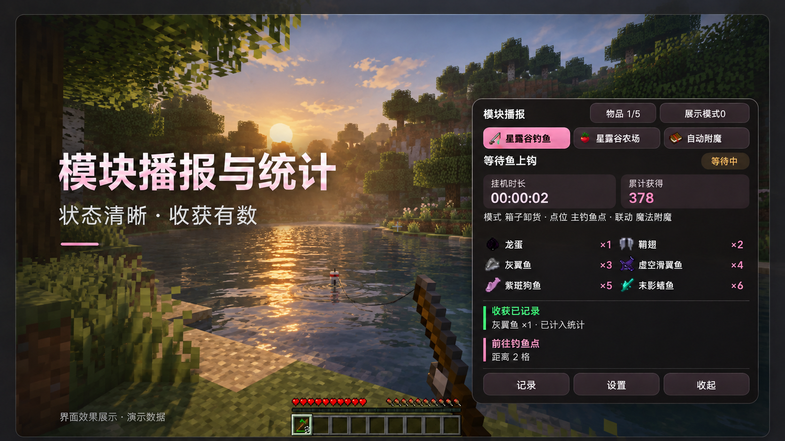

图片编辑后的河畔效果，非实测；旧方形与演示数量。当前默认精致窄形，<a href="https://github.com/fxjcangku/yiyiaddon/blob/master/%E5%B1%95%E7%A4%BA%E8%B5%84%E6%BA%90/%E6%A8%A1%E5%9D%97%E6%92%AD%E6%8A%A5%E7%BB%9F%E8%AE%A1-20261009/%E7%B2%BE%E8%87%B4%E7%AA%84%E5%BD%A2-%E5%AE%A2%E6%88%B7%E7%AB%AF%E9%A2%84%E8%A7%88.png">查看客户端原图</a>（12.6 秒/本及数量为演示）。

**yiyiaddon 1.0-beta9.1 · 历史测试版**

模块播报集中展示，优化安装包体积。

发布时支持 Minecraft **26.1.2 / 26.2**。**当前未提供下载附件，仅保留历史更新记录。**

需要安装时，请前往[当前正式版](https://github.com/fxjcangku/yiyiaddon/releases/latest)，并按当前版本说明选择安装包。

<!-- yiyiaddon:website:start -->

  <a href="https://www.yiyiaddon.asia/#gh-light-mode-only"><picture><source media="(max-width: 640px)" srcset="../展示资源/theme/website-feature-compact-light.svg?v=fdaf7a3d"></picture></a>
  <a href="https://www.yiyiaddon.asia/#gh-dark-mode-only"><picture><source media="(max-width: 640px)" srcset="../展示资源/theme/website-feature-compact-dark.svg?v=c941900b"></picture></a>

<!-- yiyiaddon:website:end -->

  
  
  
  

本版更新亮点与完整记录

## 本次亮点

- **安装包大幅瘦身** → 按公开平台精简依赖、移除其它平台原生库，字体与图标精简优化，不删除任何模块与功能；两版最终约 37 MB。
- **模块播报集中到一页** → 通知不再刷聊天，重复自动合并，历史可筛选、复制，同服关闭再开不清账目。

## 详细更新记录

按模块展开，查看该版本的原始更新内容。

<strong>更新概要</strong>

- **概要**：修复 14 项，新增 3 项，变更 7 项；重点是播报不刷屏与安装包瘦身。

<strong>模块播报与界面</strong>

- **修复**：原生物品图标空白、拖动留下多层旧面板 → 只显示一层。
- **修复**：模式与指标显示不全 → 已完整显示。
- **新增**：模块通知集中到一页 → 重复合并，历史可筛选复制。
- **新增**：多选窗口 → 分组全选与取消，只操作当前结果。
- **变更**：列表可拖动、吸附与记忆 → 首页可切换布局。

<strong>星露谷钓鱼</strong>

- **修复**：虚空抛竿被自己的鱼饵与丢弃物误挡 → 不再误挡。
- **修复**：鱼饵补给少量同步零头就停钓 → 不再停钓。
- **修复**：进服资源识别与鱼竿、鱼获图标异常 → 已修复。
- **修复**：Shift 小游戏长时间按住、过早松手 → 按危险值推进。
- **修复**：出售与全丢模式须先绑鱼箱 → 可直接原地出售。
- **修复**：小游戏取消点击后误记已发 → 取消后可继续判断。
- **变更**：Shift 四种触发方式 → 补用途说明，与经典小游戏互斥。

<strong>自动附魔</strong>

- **修复**：未显示当前策略、收集方式与档位 → 已补全并分别统计。
- **修复**：满包无法腾位 → 交自动丢弃，归还后才关台。
- **修复**：服务器迟到误停、重复附魔 → 有限同步保留原事务。
- **修复**：旧槽误判丢装备或材料 → 核对实际取料与归还。
- **修复**：装备两步合并过早叠修理费 → 优先用已有材料。
- **新增**：附魔目标写错 → 提示剔除，全部无效即停。
- **变更**：书流程减少空等 → 保留真实回执保护。

<strong>容器交接与更新</strong>

- **修复**：快速开关容器误判、完成后重复关开 → 已修复。
- **变更**：更新弹窗对比新旧版 → 标明游戏版本，按钮固定。
- **变更**：首次安装默认 → 仅开服务器检测与自动重生。
- **变更**：加强核心模块代码保护 → 更新包内声明。
- **变更**：安装包大幅瘦身 → 仅留 Windows x64，两版分包。

## 使用与验证边界

以下为该测试版发布时的适用范围与验证状态；附件现状以上方“下载与环境”为准。

- **播报操作**：约 8 秒无新播报时隐藏，新播报或打开聊天框后恢复；聊天中可拖动、缩放，深浅主题同步。
- **统计保留**：同服关闭再开不清账目，获得与入箱、出售、丢弃分开；原配置保留。
- **测试范围**：两版最终安装包已进入单人世界，并完成附魔、容器交接及挖矿专项；原服插件与长期挂机未验。
- **版本范围**：26.1.2 / 26.2 分包，26.3 暂无下载。[界面与统计说明](https://github.com/fxjcangku/yiyiaddon/blob/master/界面预览.md)

## 反馈与文档

[反馈问题](https://github.com/fxjcangku/yiyiaddon/issues) · [安装指南](https://github.com/fxjcangku/yiyiaddon/blob/master/安装指南.md) · [功能指南](https://github.com/fxjcangku/yiyiaddon/blob/master/功能指南.md) · [Discord](https://discord.gg/vwrRCtET)

发布时的补充说明

  <strong>yiyiaddon 1.0-beta9.1 · 测试版</strong> 
  模块播报不刷聊天，安装包大幅瘦身 · 历史测试记录

**公开测试阶段，部分模块与模式仍待验证；遇到问题请附复现步骤。**

<strong>发布时的下载与环境记录（非当前下载指引）</strong>

以下为发布时的原下载与安装文字，仅作历史查阅；其中的旧附件安排和“请下载 Beta9.1”等指引均不代表当前可下载。

### 原下载记录

| 游戏版本 | 安装包 | 配套 Fabric API |
| :--- | :--- | :--- |
| **26.1.2** | `yiyiaddon-1.0-beta9.1-26.1.2.zip`（原附件名，当前未提供） | `0.155.2+26.1.2` |
| **26.2** | `yiyiaddon-1.0-beta9.1-26.2.zip`（原附件名，当前未提供） | `0.161.0+26.2` |

### 原运行环境与安装说明

- **环境**：Windows x64 · Java 25 · Fabric Loader 0.19.5 及以上。
- **安装**：退出游戏，将 ZIP 内 JAR 与对应 Fabric API 放入 `mods`，移出重复旧 JAR。
- **入口**：默认按 **G** 打开界面；已内置 Baritone，无需另装。

### 当时的附件安排

- **下载范围**：仅提供 Beta9.1 安装包，旧版附件撤除；历史说明保留。

##  文档与支持

<table align="center">
<tbody>
<tr><td width="600" valign="top"><h4> 功能与界面</h4>
按模块查看配置方法与界面示例。

<a href="../功能指南.md">功能指南</a> · <a href="../界面预览.md">界面预览</a>
</td><td width="600" valign="top"><h4> 安装与兼容</h4>
核对游戏版本、Java 与 Fabric 依赖。

<a href="../安装指南.md">安装指南</a> · <a href="../版本说明.md">版本兼容</a>
</td></tr>
<tr><td width="600" valign="top"><h4> 问题与反馈</h4>
反馈时附上版本、复现步骤和截图。

<a href="https://github.com/fxjcangku/yiyiaddon/issues">提交问题</a> · <a href="../常见问题.md">常见问题</a>
</td><td width="600" valign="top"><h4> 版本与使用须知</h4>
查看历次更新，并按服务器规则使用。

<a href="../发布说明/历史版本.md">历史版本</a> · <a href="../服务器使用注意.md">使用须知</a>
</td></tr>
</tbody>
</table>

<!-- release:compatibility
| 游戏版本 | 安装包 | 配套 Fabric API |
| :--- | :--- | :--- |
| **26.1.2** | `yiyiaddon-1.0-beta9.1-26.1.2.zip`（原附件名，当前未提供） | `0.155.2+26.1.2` |
| **26.2** | `yiyiaddon-1.0-beta9.1-26.2.zip`（原附件名，当前未提供） | `0.161.0+26.2` |
-->

<!-- yiyiaddon:update-summary
{"schema":1,"version":"1.0-beta9.1","title":"模块播报不刷聊天，安装包大幅瘦身","groups":[{"module":"模块播报","items":[{"type":"优化","text":"通知集中不刷聊天，修复图标与重影；默认精致窄形，历史可筛选复制。"}]},{"module":"自动附魔","items":[{"type":"修复","text":"延迟满包核对实际取料与归还，保护装备、书和青金石；开着容器也可继续。"},{"type":"优化","text":"减少空等并有限同步重试；优化装备合并顺序，避免过早叠高修理费用。"}]},{"module":"星露谷钓鱼","items":[{"type":"修复","text":"普通与虚空小游戏取消点击后可继续判断，虚空首段有可靠时机时及时点击。"}]},{"module":"更新与设置","items":[{"type":"优化","text":"更新摘要独立滚动，操作固定可见；首次只启用服务器检测和自动重生。"}]}]}
-->