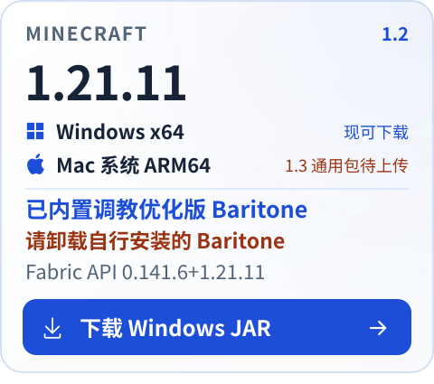
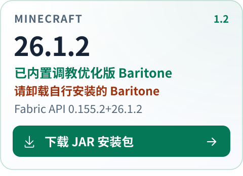
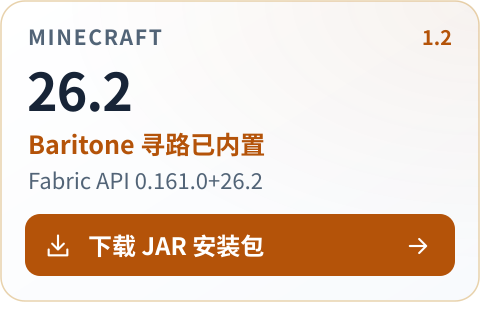
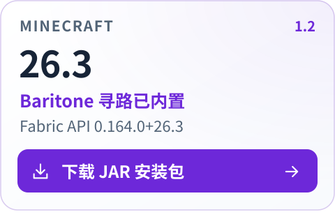

  <strong>1.2 正式版 · 星露谷农场与钓鱼 · 适配更多服务器</strong> 
  支持 Minecraft 1.21.11 / 26.1.2 / 26.2 / 26.3

  <a href="#user-content-download"><picture><source media="(prefers-color-scheme: dark)" srcset="../展示资源/theme/nav-download-dark.svg"><source media="(prefers-color-scheme: light)" srcset="../展示资源/theme/nav-download-light.svg"></picture></a>
  <a href="https://github.com/fxjcangku/yiyiaddon/blob/master/%E5%8A%9F%E8%83%BD%E6%8C%87%E5%8D%97.md"><picture><source media="(prefers-color-scheme: dark)" srcset="../展示资源/theme/nav-guide-dark.svg"><source media="(prefers-color-scheme: light)" srcset="../展示资源/theme/nav-guide-light.svg"></picture></a>
  <a href="https://github.com/fxjcangku/yiyiaddon/blob/master/%E7%95%8C%E9%9D%A2%E9%A2%84%E8%A7%88.md"><picture><source media="(prefers-color-scheme: dark)" srcset="../展示资源/theme/nav-preview-dark.svg"><source media="(prefers-color-scheme: light)" srcset="../展示资源/theme/nav-preview-light.svg"></picture></a>
  <a href="https://github.com/fxjcangku/yiyiaddon/issues"><picture><source media="(prefers-color-scheme: dark)" srcset="../展示资源/theme/nav-feedback-dark.svg"><source media="(prefers-color-scheme: light)" srcset="../展示资源/theme/nav-feedback-light.svg"></picture></a>
  <a href="https://github.com/fxjcangku/yiyiaddon/blob/master/%E5%8F%91%E5%B8%83%E8%AF%B4%E6%98%8E/%E5%8E%86%E5%8F%B2%E7%89%88%E6%9C%AC.md#stable"><picture><source media="(prefers-color-scheme: dark)" srcset="../展示资源/theme/nav-stable-dark.svg"><source media="(prefers-color-scheme: light)" srcset="../展示资源/theme/nav-stable-light.svg"></picture></a>
  <a href="https://github.com/fxjcangku/yiyiaddon/blob/master/%E5%8F%91%E5%B8%83%E8%AF%B4%E6%98%8E/%E5%8E%86%E5%8F%B2%E7%89%88%E6%9C%AC.md#beta"><picture><source media="(prefers-color-scheme: dark)" srcset="../展示资源/theme/nav-beta-dark.svg"><source media="(prefers-color-scheme: light)" srcset="../展示资源/theme/nav-beta-light.svg"></picture></a>

本次重点完善星露谷农场与钓鱼的资源包识别、多服适配和作业稳定性，同时更新指令帮助、聊天界面与运行统计。

**Baritone 寻路已整合进 yiyiaddon 的 JAR，无需另外下载或安装 Baritone。**

## 下载与安装

选择与你的 **Minecraft 版本一致** 的安装包，点击下方按钮直接下载。

  <a href="https://github.com/fxjcangku/yiyiaddon/releases/download/v1.2/yiyiaddon-1.2-1.21.11.jar"><picture><source media="(prefers-color-scheme: dark)" srcset="../展示资源/theme/download-1.21.11-dark.svg"><source media="(prefers-color-scheme: light)" srcset="../展示资源/theme/download-1.21.11-light.svg"></picture></a>
  <a href="https://github.com/fxjcangku/yiyiaddon/releases/download/v1.2/yiyiaddon-1.2-26.1.2.jar"><picture><source media="(prefers-color-scheme: dark)" srcset="../展示资源/theme/download-26.1.2-dark.svg"><source media="(prefers-color-scheme: light)" srcset="../展示资源/theme/download-26.1.2-light.svg"></picture></a>
  <a href="https://github.com/fxjcangku/yiyiaddon/releases/download/v1.2/yiyiaddon-1.2-26.2.jar"><picture><source media="(prefers-color-scheme: dark)" srcset="../展示资源/theme/download-26.2-dark.svg"><source media="(prefers-color-scheme: light)" srcset="../展示资源/theme/download-26.2-light.svg"></picture></a>
  <a href="https://github.com/fxjcangku/yiyiaddon/releases/download/v1.2/yiyiaddon-1.2-26.3.jar"><picture><source media="(prefers-color-scheme: dark)" srcset="../展示资源/theme/download-26.3-dark.svg"><source media="(prefers-color-scheme: light)" srcset="../展示资源/theme/download-26.3-light.svg"></picture></a>

| Minecraft | 配套 Fabric API | Java |
| --- | --- | --- |
| **1.21.11** | `0.141.6+1.21.11` | **21** |
| **26.1.2** | `0.155.2+26.1.2` | **25** |
| **26.2** | `0.161.0+26.2` | **25** |
| **26.3** | `0.164.0+26.3` | **25** |

**运行环境：Windows x64 · Fabric Loader 0.19.5+**

1. 退出游戏，将对应版本的 **yiyiaddon JAR** 和配套 **Fabric API** 放入实例的 `mods` 文件夹。
2. 移出旧版或重复的 yiyiaddon JAR。
3. 启动游戏，默认按 **G** 打开界面，再按模块说明完成配置。

[详细安装指南 →](https://github.com/fxjcangku/yiyiaddon/blob/master/%E5%AE%89%E8%A3%85%E6%8C%87%E5%8D%97.md) &nbsp; · &nbsp; [版本与兼容 →](https://github.com/fxjcangku/yiyiaddon/blob/master/%E7%89%88%E6%9C%AC%E8%AF%B4%E6%98%8E.md)

## 本次亮点

| 更新方向 | 主要变化 |
| --- | --- |
| **星露谷农场** | 强化混淆资源包与作物识别，完善收获补种、补给卸货和浇水流程。 |
| **星露谷钓鱼** | 完善鱼类与钓具模型识别，优化岩浆快速绿条的跟随与制动。 |
| **1.21.11 适配** | 物品、生物与附魔选择器按本版加载，统一 HUD 与播报图标。 |
| **使用体验** | 更新 `.help` 帮助页、聊天设置与自动消息窗口，完善任务统计和取证反馈。 |

## 详细更新记录

按模块展开，查看具体调整。

<strong>星露谷农场 · 作物识别与收获补种</strong>

- **资源包与成熟识别**：解析混淆资源包，强化作物识别；修复新苗误挖、位置错位及刚种下就尝试采收的问题。已识别的新苗显示“生长中”，未知状态保留为“待确认”，不使用左键试挖。
- **收获与补种**：自动右键学习并腾空副手；成熟后持种子同击收播，无效时回退到已验证的空手方案，新苗不重复补种。
- **种子调度**：就近收播、按缺口备种；修复只取 8 颗种子、种子耗尽后仍发包，以及跨物品堆卡住的问题。
- **逐作物配置**：分别设置种植区域、种子箱和品质箱，避免误用旧公共箱；分箱齐全时，旧卸货点不再阻塞启动。
- **批量配置**：支持种植、卸货与品质分区批量设置；固定田种满，混种可设置数量，卸货组数／个数上限为 **9999**。
- **产物信息**：修复名称污染、列表滚动回弹及多箱卡顿；产物不限三档，名称、星级与颜色取自实物，未知信息不推测。

<strong>星露谷农场 · 区域作业、补给仓储与灌溉</strong>

- **补给与缺货**：种子用尽后不再反复往返空箱；缺货时暂停对应作物，关闭补货后仅使用随身种子。
- **扫描与作业距离**：减少重复扫田和空位占用批量名额；默认距离 **6 格**，超距时继续靠近。解除圈地与总扫描量限制，分帧处理已加载区块，避免漏扫远田，区块卸载不误报完成。
- **批量锄地**：限速后继续发送剩余操作、不重复发送；修复漏格、反复切换目标及作物通路受阻的问题。
- **容器交互**：修复高箱、密集箱、木桶以及半砖、活版门附近的交互，并保护绊线；受阻箱不拖住其他作物，同箱标记合并显示。
- **连续作业与卸货**：修复处理单株后停住、卸货折返，以及漏斗腾空容器导致误停的问题；支持潜影盒原位换盒续卸，回收空瓶与空桶。
- **浇水与洒水器**：修复水量、补水回执及洒水器灌水，补水后继续浇水；批量操作不受种植配额限制，未绑定时可预览，缺少证据的内容标为“未知／示意”。

区域调度、箱子与区域 ESP 的两项调整仍待验证，具体范围见下方“验证进度”。

<strong>星露谷钓鱼 · 模型识别与绿条跟随</strong>

- 修复大资源包漏扫、鱼类合并及装饰模型误识别，完善鱼类与钓具模型。
- 优化岩浆快速绿条的跟随与制动；隐藏选项继续保留原值。

<strong>自动驱魔 · 菜单学习与批量处理</strong>

- 学习本服菜单，优先提取目标、拆除必要前置并保留原书。
- 批量取件后逐件处理，支持分类箱及装备附魔批量配置。
- 修复后位目标、禁用词条、重启学习档、漏结算、旧领件及配置锁死等问题，完善补经验武器与朝向。

<strong>飞行绕过 · 起飞与状态衔接</strong>

- 修复无法起飞或掉落的问题，支持切换世界后继续飞行。
- 保留双击退出、纠正下降及液体衔接。

<strong>聊天增强与 .help · 界面和操作体验</strong>

- **指令帮助**：`.help` 主题帮助页支持拖动、分类和用法搜索，不受聊天行数限制；点击填入指令时保留草稿，修复离服清理与迟到回调。
- **历史记录**：修复异常悬停拖垮历史恢复的问题；有变化时后台保存，保护换服、清理与退出时的数据。
- **消息显示与发送**：修复跨区及死亡头像、称号隐藏、“@我”假角标等问题，完善频道发送与本地指令交接。
- **设置窗口**：重做聊天设置与自动消息窗口，支持拖动缩放、独立滚动和分组草稿，简化指令填写。

<strong>界面与公共功能 · 统计、资源包与取证</strong>

- **运行统计**：新增／完善农场逐作物统计和学习详情，四页共用概览以减少切页跳动；完善真实图标、分类通知及全文显示。
- **版本适配**：1.21.11 的物品、生物与附魔选择器按本版加载；HUD 与播报记录统一图标和配色。
- **资源包加载**：修复同包重复提取中断农场、加载后撤包、菜单紫黑及字形异常，优化重连缓存。
- **模块取证**：完善详细取证，修复停止后回执消失和导出失败，支持从回执直达日志目录。
- **作物取证**：支持未开启农场、未圈田、先种后录的情况，区分右键线索、单手证据与采后补种。
- **学习保存**：执行 `.stardew 作物取证 停止` 并导出后，保存合格的采收学习；按服务器／资源包隔离，缺少证据时不覆盖已有学习。

## 验证进度

**已完成的受控单人验证**

- **26.1.2 / 26.2 / 26.3**：扫描、种收与 HUD 已通过验证。
- **26.2 锄地**：10 × 10 场景两场通过；关闭限速时最高同刻 **15 格**，默认限速下的续发通过。
- **26.2 补给**：空箱不折返通过，原服表现仍待验证。

<strong>查看 26.2 农场耗时对照</strong>

测试条件：**受控单人 16 × 16**，批量 **15**／距离 **6**／扫描 **16**。

| 测试环节 | 对照省时 |
| --- | --- |
| 取种与播种 | **48.8%** |
| 采收与拾取 | **53.4%** |
| 合计 | **51.4%** |

以上数据仅对应上述测试条件，原服效果待验证。

**仍待验证的调整**

- **区域调度**：区外空闲时返回已选田，同维度多区域随机轮换；聊天时可短走，人工操作后重新等待。
- **箱子与区域 ESP**：隐藏未选作物的箱子／区域 ESP，重新选择后恢复显示并保留绑定；运行时不另设 32 格限制，保留全局视距。
- **原服复测**：作物周期、品质与驱魔报价仍待复测。

## 使用与反馈

不同服务器的资源包和菜单规则不同，农场、钓鱼与驱魔请按本服条件配置。

[提交问题 →](https://github.com/fxjcangku/yiyiaddon/issues) 时，请附上 **Minecraft 版本、模组版本和复现步骤**。

[功能指南](https://github.com/fxjcangku/yiyiaddon/blob/master/%E5%8A%9F%E8%83%BD%E6%8C%87%E5%8D%97.md) &nbsp; · &nbsp; [常见问题](https://github.com/fxjcangku/yiyiaddon/blob/master/%E5%B8%B8%E8%A7%81%E9%97%AE%E9%A2%98.md) &nbsp; · &nbsp; [服务器使用注意](https://github.com/fxjcangku/yiyiaddon/blob/master/%E6%9C%8D%E5%8A%A1%E5%99%A8%E4%BD%BF%E7%94%A8%E6%B3%A8%E6%84%8F.md)

